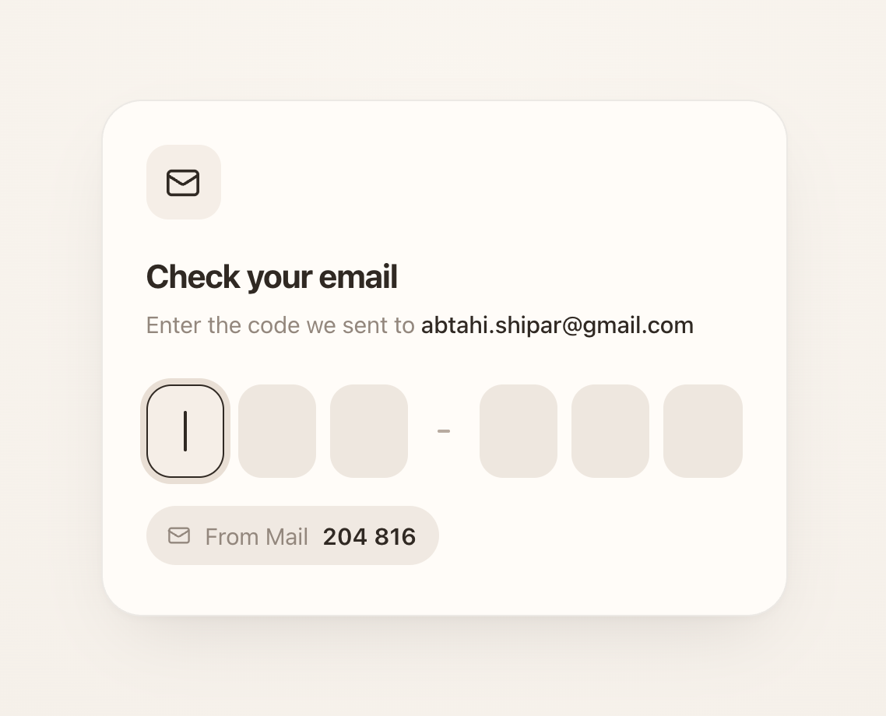
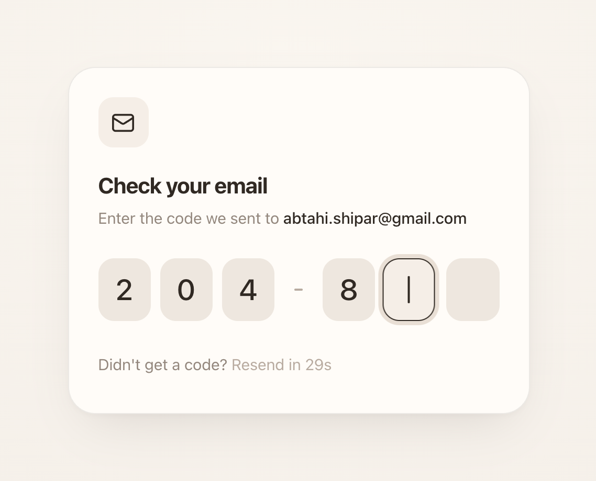
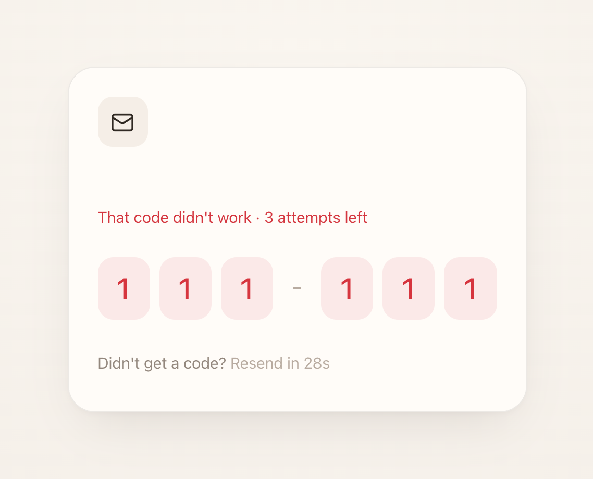
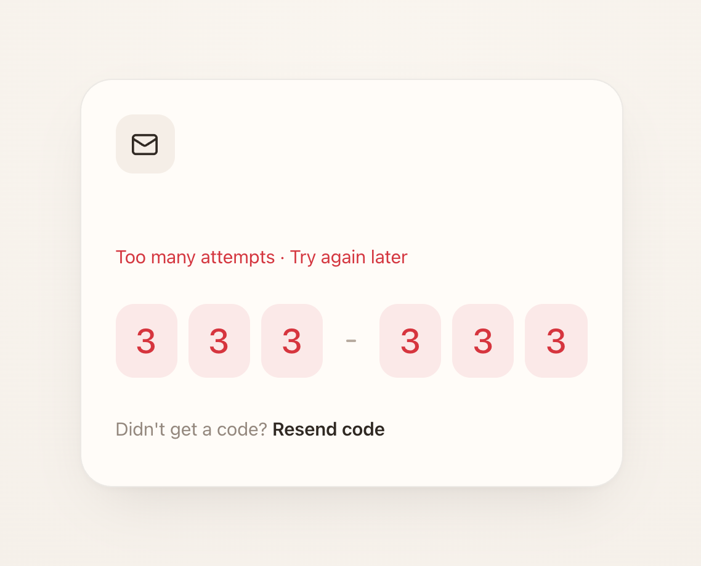
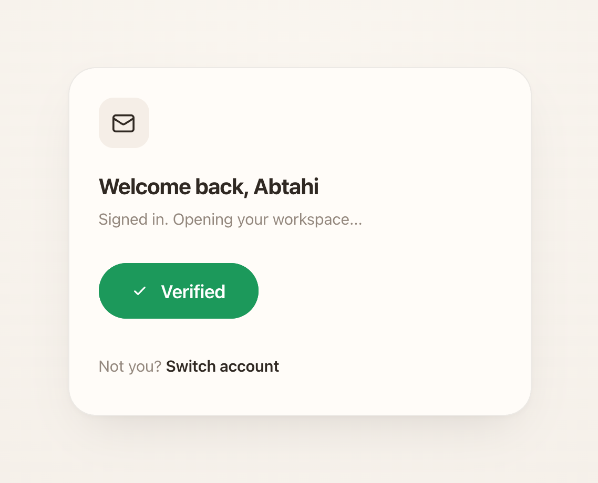
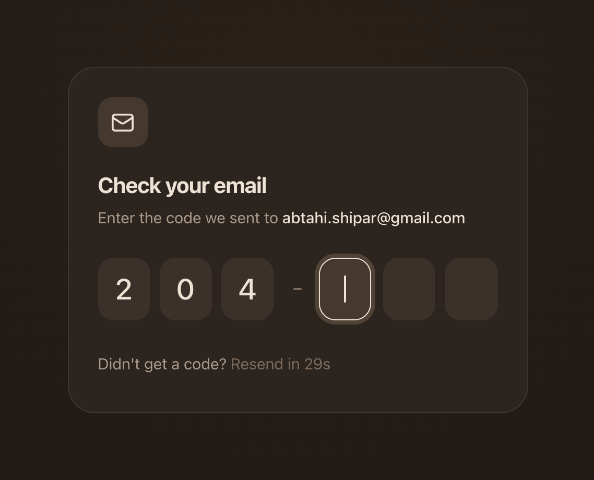
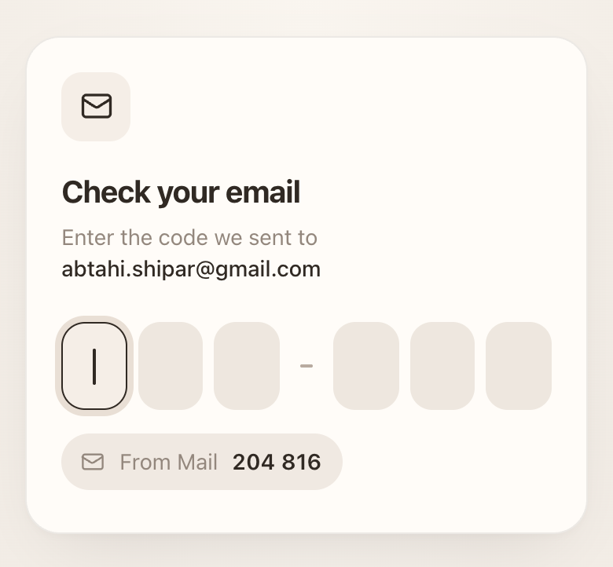

# Modern OTP Input V2

A dependency-free one-time-code card built around a sliding focus plate, Mail autofill, attempt feedback, and a verified pill. No frameworks, no build step, no runtime dependencies.

**Live demo:** [otp-input-v2.vercel.app](https://otp-input-v2.vercel.app)



## Overview

This is a small interaction study: a six-digit verification field that treats every state as part of one continuous motion. A single spring-driven plate follows the active cell, digits blur in and out, failed codes drain right-to-left, and a successful code collapses the entire row into a green `Verified` pill.

The field is a real `<input>` layered invisibly over presentational cells, so native keyboards, paste, and `autocomplete="one-time-code"` keep working while the visuals stay fully custom. All animation is CSS and the Web Animations API, with reduced-motion fallbacks throughout.

## States

| State | What happens |
| --- | --- |
| **Idle** | The plate sits on the first empty cell with a blinking caret. The `From Mail 204 816` suggestion chip appears when the field is focused and empty. |
| **Typing** | The plate springs to the next cell on a light spring (`k = 240`, `c = 31`). New digits fade up from a 6px blur; deletions fade out. |
| **Verifying** | Once six digits are in, the input locks and the digits pulse in a staggered wave while the code is checked. |
| **Error** | Cells and copy turn red, the attempt count blurs from one number to the next, and the digits dissolve right-to-left. |
| **Lockout** | After three wrong codes the copy becomes `Too many attempts · Try again later`, the field locks, and Resend becomes available. |
| **Autofill** | Choosing the Mail suggestion fills the digits one at a time, then runs verification automatically. |
| **Success** | Cells turn green, the copy crossfades to `Welcome back, Abtahi`, the digits blur out, and the row merges into a green `Verified` pill. |
| **Reset** | `Switch account` animates the pill back into six cells, clears the code, and restores the initial state. |

### State gallery

| Idle + Mail suggestion | Typing + sliding plate |
| --- | --- |
|  |  |

| Wrong code | Locked out after three attempts |
| --- | --- |
|  |  |

| Verified pill | Dark theme |
| --- | --- |
|  |  |

| Mobile layout |
| --- |
|  |

## Try it

The demo code is **204816**, also surfaced by the Mail suggestion chip.

- Type or paste digits — non-numeric characters are stripped and the field is capped at six.
- Focus an empty field to reveal `From Mail 204 816`; click or tap it to autofill and auto-verify.
- Enter any other six-digit code to see the error, countdown, and clear animations.
- Fail three times to see the lockout state; `Resend code` unlocks the field, resets attempts, and restarts the 30-second timer.
- After a successful verification, `Switch account` collapses the pill back into the six cells.
- Use the theme toggle in the top right to move between the warm light and dark palettes. The choice persists in `localStorage`; first visits follow `prefers-color-scheme`.

## Implementation notes

- **Sliding plate** — a spring integrator runs on `requestAnimationFrame`, animating `translateX` toward the active cell's `offsetLeft` and sizing itself to the cell width. Geometry is re-measured on resize.
- **One input, two layers** — the transparent input keeps native selection, paste, and mobile OTP keyboard behavior; the cells, plate, caret, and pill are purely presentational.
- **Digit transitions** — the Web Animations API drives blur/opacity in both directions, so rapid edits do not leave stale styles behind.
- **Copy crossfades** — the footer is a CSS grid stack; each variant is shown by a `data-copy` flag on the card, with blur transitions.
- **Success merge** — `data-phase="merging" | "pill"` on the field animates width, height, gap, radius, and background so the six cells become one pill; the `Verified` label is an overlay.
- **Reset merge** — `data-phase="reset" | "split"` runs the same geometry in reverse.
- **Accessibility** — a visually hidden status region announces verification, errors, remaining attempts, and resets; the input has an explicit label; interactive controls expose `:focus-visible` outlines; the suggestion chip is skipped in tab order because keyboard users can simply type. `prefers-reduced-motion` removes the spring and blur motion.
- **Theming** — warm neutral tokens are defined once in CSS custom properties, with a `[data-theme="dark"]` override and no layout change between themes.

## Getting started

No install step is required.

```bash
npm run dev      # static server at http://127.0.0.1:5188
npm run build    # copies runtime files into dist/
```

The page also works when `index.html` is opened directly from disk.

## Project structure

```
.
├── index.html        # card markup and state copy
├── otp-v2.css        # tokens, layout, plate, pill, themes, breakpoints
├── otp-v2.js         # plate spring, typing, verification, attempts, reset, theme
├── serve.cjs         # zero-dependency local static server
├── build.cjs         # copies runtime files into dist/
└── docs/             # state screenshots used in this README
```

## Browser support

Modern evergreen browsers with the Web Animations API, CSS custom properties, `color-mix()`, and `svh` units. Verified in Chrome; the layout and motion degrade cleanly in browsers that honor reduced-motion settings.

## Notes and limitations

- This is a front-end interaction demo. The code (`204816`) is hard-coded and verification happens on the client; production use needs a real verification endpoint and rate limiting on the server.
- The `From Mail` chip simulates an OS autofill suggestion. On a real device, the input's `autocomplete="one-time-code"` and `inputmode="numeric"` let the platform supply the code.
- Attempts are intentionally not persisted across reloads.
- The theme choice is stored per browser via `localStorage`.

## License

MIT © 2026 Abtahi Shipar
